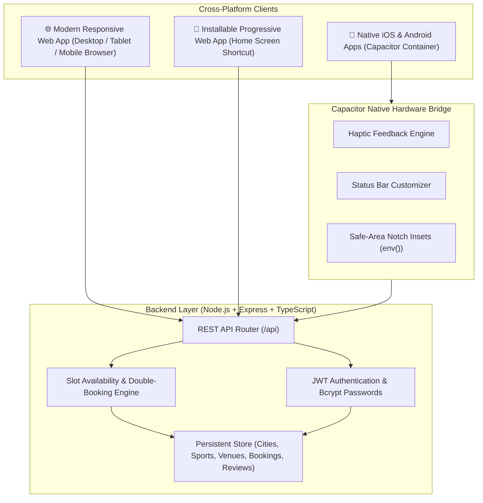

# ⚡ Book My Game — Kurnool Turf & Court Slot Reservation Platform

A production-grade, full-stack sports venue discovery and hourly slot booking system built **website-first**, engineered to convert directly into native **iOS and Android mobile apps** with zero rewrite.

---

## 🏟️ Platform Overview

* **Domain**: Hyperlocal sports turf, court, and swimming pool reservations.
* **Target Location**: Kurnool, Andhra Pradesh (with multi-city database support).
* **Sports Supported**: Badminton 🏸, Cricket Nets 🏏, Football Turfs ⚽, Swimming Pools 🏊, Tennis Courts 🎾, Basketball 🏀.
* **Core Value**:
  * **Instant Live Slot Matrix**: Eliminates phone calls and double bookings by computing real-time slot availability.
  * **Zero Friction**: Pay at venue (Cash / UPI) upon arrival with a unique reference code (`BMG-XXXXXX`).
  * **Turf Owner Portal**: Operators list facilities, configure operating schedules, and monitor booking calendars.

---

## 🏛️ System Architecture



---

## 📁 Repository Structure

```text
book-my-game/
├── backend/                       # RESTful Node.js + Express API
│   ├── src/
│   │   ├── controllers/           # Auth, Venues, Bookings, Owner Controllers
│   │   ├── db/                    # Persistent Store with seed data for Kurnool
│   │   ├── middleware/            # JWT Token verification middleware
│   │   ├── routes/                # Express API routes (/auth, /venues, /bookings, /owner)
│   │   ├── types/                 # Shared TypeScript interfaces (Venue, Slot, Booking, User)
│   │   └── server.ts              # Server bootstrap with dynamic CORS
│   ├── package.json
│   └── tsconfig.json
│
├── frontend/                      # Mobile-First Sports Web Application
│   ├── src/
│   │   ├── components/            # LandingView, VenuesCatalogView, SlotBookingModal, OwnerPortal
│   │   ├── services/api.ts        # API Client with auto-host detection (Web / Android Emulator)
│   │   ├── utils/device.ts        # Native Capacitor bridge (Haptics, Status bar)
│   │   ├── types/index.ts         # Frontend data interfaces
│   │   ├── App.tsx                # Main App shell with Mobile Simulator
│   │   └── index.css              # Dark athletic styling with neon green accents
│   ├── capacitor.config.json      # Capacitor native mobile bridge configuration
│   ├── package.json
│   ├── tailwind.config.js
│   └── vite.config.ts
│
├── package.json                   # Monorepo build and development scripts
└── README.md                      # Comprehensive documentation
```

---

## ⚡ Quick Start (Local Development)

### 1. Start the Backend API (Port 5000)
Open your terminal in the project directory:
```powershell
cd C:\Users\USER\.gemini\antigravity\scratch\book-my-game\backend
npm.cmd run dev
```
* **API Root:** `http://localhost:5000`
* **Health Check:** `http://localhost:5000/api/health`
* **Android Emulator Host:** `http://10.0.2.2:5000`

### 2. Start the Frontend Web App (Port 5173)
In a second terminal:
```powershell
cd C:\Users\USER\.gemini\antigravity\scratch\book-my-game\frontend
npm.cmd run dev
```
* Open `http://localhost:5173` in your browser.
* Toggle the **"Mobile Preview"** button on the top right to test the mobile layout inside a simulated iPhone/Android frame!

---

## 🔑 Demo Accounts for Testing

| Role | Email | Password | What You Can Do |
| :--- | :--- | :--- | :--- |
| **Player** | `player@kurnool.dev` | `password123` | Book court slots, view reservations, cancel upcoming games. |
| **Turf Owner** | `owner@kurnoolturf.com` | `password123` | Access Owner Dashboard, add venues, pause/activate listings, mark games as played. |

---

## 📱 How to Convert into Android APK & iOS Mobile App

### Step 1: Compile Production Web Assets
```powershell
cd frontend
npm.cmd run build
```

### Step 2: Generate Native Mobile Project
```powershell
# For Android (Google Play Store):
npx.cmd cap add android

# For iOS (Apple App Store - Requires macOS):
npx.cmd cap add ios
```

### Step 3: Open in Android Studio to Build APK
```powershell
npx.cmd cap open android
```
In Android Studio:
1. Click **Build** > **Build Bundle(s) / APK(s)** > **Build APK(s)**.
2. Transfer the `.apk` file to your Android phone to install and test directly.

### Step 4: Sync Updates
Whenever you modify frontend code, run:
```powershell
npm.cmd run mobile:sync
```
This automatically updates your native Android and iOS projects with your latest code!
